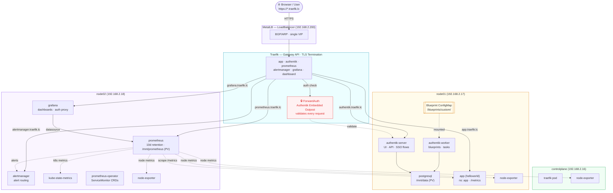

# Kubernetes Homelab

A fully automated 3-node Kubernetes homelab provisioned with **Vagrant** and **Ansible**. One `vagrant up` brings up the entire cluster with SSO, observability, TLS termination, and a sample application — no manual steps required.

Tried it and something broke? [Open an issue](https://github.com/alphakaps/vagrant-kubernetes/issues), see [Reporting a problem](#reporting-a-problem).



---

## Stack

| Layer | Tool | Version |
|---|---|---|
| VM provisioning | Vagrant + VirtualBox | Ubuntu 24.04 (`bento/ubuntu-24.04`) |
| Configuration management | Ansible | |
| Container runtime | containerd | |
| Kubernetes | kubeadm + Flannel | v1.34 |
| Package manager | Helm | v3.22.0 (pinned, checksum-verified) |
| Ingress / Gateway | Traefik (Gateway API) | chart 42.1.3 · Traefik v3.7 · Gateway API CRDs v1.6.3 |
| Load balancer | MetalLB | L2 mode |
| SSO | Authentik | chart 2026.8.5 |
| Observability | kube-prometheus-stack | Prometheus, Alertmanager, Grafana |
| Sample app | hashicorp/http-echo | |

The Traefik and Authentik charts are pinned on purpose: Traefik chart v42 renamed its logging values and stopped shipping the Gateway API CRDs, which broke unpinned installs.

---

## Cluster layout

| Node | IP | CPU / RAM | Role | Workloads |
|---|---|---|---|---|
| controlplane | 192.168.2.16 | 2 / 2 GB | Control plane | Traefik, CoreDNS, Flannel |
| node01 | 192.168.2.17 | 2 / 4 GB | Worker | Authentik PostgreSQL, sample app, Authentik server or worker |
| node02 | 192.168.2.18 | 2 / 4 GB | Worker | Prometheus, Alertmanager, Grafana, Authentik server or worker |

MetalLB exposes a single LoadBalancer IP: **192.168.2.200**

The Authentik server and worker are scheduled on different workers when possible, so they don't compete for memory.

---

## Prerequisites

| | Minimum |
|---|---|
| Host RAM | 16 GB (the VMs use 10 GB) |
| Host CPU | 6 cores (2 per VM) |
| Free disk | ~30 GB |
| [Vagrant](https://developer.hashicorp.com/vagrant/install) | >= 2.3 |
| [VirtualBox](https://www.virtualbox.org/wiki/Downloads) | >= 7.0 |
| [Ansible](https://docs.ansible.com/ansible/latest/installation_guide/) | >= 2.14, installed on the host |

Internet access is required during provisioning (apt, Helm charts, container images).

---

## Quick start

```bash
git clone https://github.com/alphakaps/vagrant-kubernetes.git
cd vagrant-kubernetes

# Set the Authentik admin password (this file is gitignored)
cp ansible/kubernetes/group_vars/all/secrets.yml.example ansible/kubernetes/group_vars/all/secrets.yml
# edit secrets.yml and replace "change-me"

vagrant up
```

The provisioner will:
1. Boot three Ubuntu 24.04 VMs
2. Install containerd, Kubernetes and Helm, then initialize the control plane
3. Join node01 and node02 and pre-pull the Authentik image on them
4. Deploy MetalLB, the Gateway API CRDs, Traefik, Authentik, the sample app and the observability stack

Provisioning takes about 20 minutes. **Authentik needs a few more minutes after that** to create its database on first boot. Until it's ready, https://app.traefik.lc returns `500`, `503` or an Authentik "Not Found" page. Check progress with:

```bash
kubectl -n authentik get pods   # wait until server and worker are 1/1
```

Ansible copies the cluster's kubeconfig to `~/.kube/config` on the host, so `kubectl` works from your machine.

### /etc/hosts

Add the following entries on your host machine so the `.traefik.lc` domains resolve to MetalLB:

```
192.168.2.200 authentik.traefik.lc
192.168.2.200 app.traefik.lc
192.168.2.200 dashboard.traefik.lc
192.168.2.200 prometheus.traefik.lc
192.168.2.200 alertmanager.traefik.lc
192.168.2.200 grafana.traefik.lc
```

---

## Access

All services are exposed over HTTPS on port 443 with a self-signed certificate (accept the browser warning).

| Service | URL | Credentials |
|---|---|---|
| Sample app | https://app.traefik.lc | via Authentik SSO |
| Prometheus | https://prometheus.traefik.lc | via Authentik SSO |
| Traefik dashboard | https://dashboard.traefik.lc/dashboard/ | `admin` / `password` |
| Authentik | https://authentik.traefik.lc | `akadmin` / your `authentik_bootstrap_password` |
| Alertmanager | https://alertmanager.traefik.lc | via Authentik SSO |
| Grafana | https://grafana.traefik.lc | via Authentik SSO |

> The `akadmin` password is applied only when the Authentik database is first created. If you skipped `secrets.yml`, set it once at https://authentik.traefik.lc/if/flow/initial-setup/

---

## Daily use

| Task | Command | Notes |
|---|---|---|
| Stop the lab | `vagrant halt` | Keeps all data |
| Start it again | `vagrant up` | Authentik is back in about a minute, no first-boot setup |
| Rebuild from scratch | `vagrant destroy -f && vagrant up` | Data is lost, full first boot again |
| Re-run only the Helm/apps step | see below | |

```bash
ansible-playbook -i .vagrant/provisioners/ansible/inventory/vagrant_ansible_inventory \
  ansible/kubernetes/kubernetes-playbook.yml --limit controlplane --tags utilities \
  -e cp_ip=192.168.2.16 -e kn01_ip=192.168.2.17 -e kn02_ip=192.168.2.18
```

---

## Features

### TLS termination
Traefik terminates TLS using a self-signed certificate stored as a Kubernetes Secret. All HTTP traffic is permanently redirected to HTTPS.

### Gateway API routing
All routes are defined as `HTTPRoute` resources (Kubernetes Gateway API), with no `Ingress` objects. Traefik acts as the Gateway controller. The Gateway API CRDs are installed separately, because the Traefik chart no longer ships them.

### SSO with Authentik
Authentik is configured automatically via a **Blueprint** (ConfigMap mounted at `/blueprints/custom/`). The blueprint provisions:
- Proxy providers for `app`, `prometheus`, `alertmanager`, and `grafana`
- Applications linked to each provider
- The embedded outpost with all four providers attached

No manual UI configuration is needed. The embedded outpost handles ForwardAuth for all protected routes.

### Observability
- **Prometheus** scrapes cluster metrics with 10-day retention, stored on a hostPath PV on node02
- **Grafana** ships with three pre-loaded community dashboards: Traefik, Node Exporter Full, Kubernetes Views Pods
- **kube-state-metrics** exposes Kubernetes object metrics
- **ServiceMonitor** scrapes the sample app's `/metrics` endpoint every 30s
- Grafana authentication is handled via Authentik proxy header (`X-authentik-username`), with no separate Grafana login

### Persistent storage
| Workload | PV | Path | Node | Owner |
|---|---|---|---|---|
| Authentik PostgreSQL | `pv-static` | `/mnt/data` | node01 | `1001:1001` |
| Prometheus | `pv-prometheus` | `/mnt/prometheus` | node02 | `1000:2000` |

Both directories are pre-created by Ansible before the Helm installs run. Each PV has a `claimRef`, so it can only bind to its own workload.

---

## Troubleshooting

| Symptom | Cause | Fix |
|---|---|---|
| `500`, `503` or Authentik "Not Found" on the apps right after install | Authentik is still creating its database or applying the blueprint | Wait until `kubectl -n authentik get pods` shows server and worker `1/1` |
| Authentik pods restart again and again | Not enough memory on the workers | Check the workers have 4 GB (`Vagrantfile`) and the host has free RAM |
| Site unreachable or times out | Wrong URL or missing `/etc/hosts` entries | Use `https://…traefik.lc` with no port, and add the hosts entries above |
| `Helm installation failed` during provisioning | Download from get.helm.sh failed | Check internet access from the VMs, then run `vagrant provision controlplane` |
| `no matches for kind "HTTPRoute"` | Gateway API CRDs missing | Re-run the utilities step (see Daily use) |
| Guest additions version warning from Vagrant | Box and VirtualBox versions differ | Usually harmless; upgrade VirtualBox if shared folders fail |

---

## Reporting a problem

If `vagrant up` fails for you, please [open an issue](https://github.com/alphakaps/vagrant-kubernetes/issues) with:
- Your OS and host RAM
- `vagrant --version`, `VBoxManage --version`, `ansible --version`
- The failing Ansible task and its error (the `fatal:` block)
- If the cluster came up: `kubectl get pods -A`

---

## Project structure

```
vagrant-kubernetes/
├── Vagrantfile
├── ansible/kubernetes/
│   ├── kubernetes-playbook.yml
│   ├── group_vars/all/
│   │   ├── main.yml
│   │   └── secrets.yml.example   # copy to secrets.yml (gitignored)
│   └── roles/
│       ├── control-plane/      # kubeadm init, Helm, CoreDNS patch
│       ├── workers/            # kubeadm join, hostPath dirs, image pre-pull
│       ├── utilities/          # Helm charts, manifests, app
│       └── clean/              # tear-down tasks
└── app/                        # Sample app manifests (source of truth)
```

---

## Tear down

```bash
vagrant destroy -f
```

---

## Known limitations

- Self-signed TLS certificate, so browsers show a security warning
- No external DNS; `/etc/hosts` entries must be added manually on the host
- hostPath volumes are tied to specific nodes, and data is lost on `vagrant destroy`
- The Authentik `secret_key`, the PostgreSQL password and the Traefik dashboard password are committed in plain text (lab use only)
